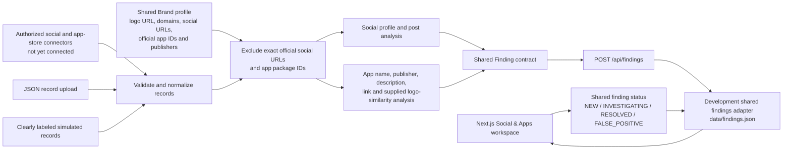

# Social & App Monitoring architecture

## Implemented boundary

`src/lib/social-monitoring.ts` contains deterministic analysis for supplied
social profiles/posts and mobile-app listings. `src/app/api/monitoring/scan`
validates candidate records against a selected shared Brand and returns shared
Findings tagged with their origin as connected/imported/demo. The responsive
workspace at `/monitoring` imports JSON or loads simulated examples, then saves
the returned findings through `POST /api/findings`. The shared findings API
uses `src/lib/findings-store.ts` as its development JSON adapter. The workspace
filters persisted findings, displays evidence, and updates investigation
status. The existing Brand profile form stores
official domains, social profile URLs, app package IDs, publisher names, and a
logo URL.

No external source is connected. URL handling parses supplied links but does
not open them. Logo similarity is accepted only when supplied as a record
signal; image fetching and comparison are not implemented. The development
findings repository is a JSON adapter for the shared Finding contract, not a
separate social-only database. Replace it with the existing Prisma Finding
model for production persistence.

## Official-asset exclusion

Social identity signals are suppressed when a candidate's configured platform
and normalized handle or profile URL exactly match a Brand social profile.
App impersonation analysis is skipped for exact configured package IDs. Other
signals on a real social profile can still be retained for review. Name
similarity, publisher mismatch, supplied logo similarity, and unlisted domains
are indicators; they do not establish fraud.
