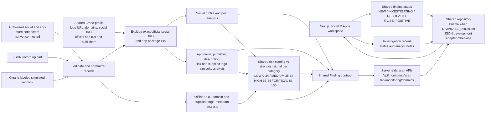

# Social & App Monitoring architecture

## Implemented boundary

`src/lib/social-monitoring.ts` contains deterministic analysis for supplied
social profiles/posts and mobile-app listings. `src/lib/domain-monitoring.ts`
analyzes submitted URL strings and manually supplied page metadata. The scan
APIs validate a selected shared Brand, calculate versioned risk breakdowns,
and persist shared Findings server-side. The public import route assigns
imported or demo provenance server-side; client records cannot claim connected
source reliability. Repeated scans update the matching
brand/source/entity record and preserve its status while merging evidence.
The workspace imports JSON or loads simulated examples. The separate
`/domains` workspace accepts one URL per line. Both show actual saved findings.
The Prisma repository is selected when `DATABASE_URL` is configured; otherwise
JSON adapters use `SENTRIX_DATA_DIR` (default `data/`). Investigation records
and notes use the shared repository boundary.

No external source is connected. Domain analysis parses submitted URLs but
does not open them. Logo similarity is accepted only when supplied as a record
signal; image fetching and comparison are not implemented. The risk score is
the sum of the strongest contribution in each independent category, capped at
100; source reliability contributes to confidence, not the risk score. The
dashboard exposure index is separately defined as the highest active finding
plus five points for each additional source family, capped at 15 corroboration
points. It is a prioritization heuristic, not a probability.

PostgreSQL stores shared findings, memberships, official assets, investigation
records, notes, and score breakdowns. The current app still uses the
fixed `org_demo` auth context. Authenticated login, membership role checks,
rate limiting, and live source adapters must be integrated before production
deployment.

## Official-asset exclusion

Social identity signals are suppressed when a candidate's configured platform
and normalized handle or profile URL exactly match a Brand social profile.
App impersonation analysis is skipped for exact configured package IDs.
Domain/website URL findings are suppressed for exact configured official
domains and their subdomains. Other signals on a real social profile can still
be retained for review. Name similarity, publisher mismatch, supplied logo
similarity, and unlisted domains are indicators; they do not establish fraud.
