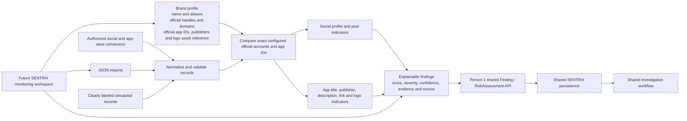

# Social & App Monitoring — prototype architecture

## Current implementation boundary

Implemented in this branch: brand-profile records and validation, social and
app candidate models, deterministic analysis, JSON parsing functions, demo
records, evidence-linked findings, and in-memory filters. URL analysis parses
provided links but makes no network requests. Logo similarity is accepted as
an input from a separate image-analysis component; this module does not
compute image similarity itself.

Not implemented yet: platform/store connectors, upload UI, SENTRIX shared
contracts, persistence, status updates, and the responsive monitoring
workspace. The finding conversion point is `Finding` in `detector.py`; adapt
that boundary when Person 1 publishes the shared contract. Do not persist this
temporary model as a separate social-only database.

## Official-asset exclusion

Configured social accounts are matched by platform and normalized handle.
Configured apps are matched by store and exact app/package ID. These exact
matches suppress identity-impersonation signals. Other evidence, such as a
suspicious link or scam-associated text, remains visible for human review.
Name similarity, publisher mismatch, logo similarity, and external domains
are review indicators; no score establishes that a profile or app is
fraudulent.
